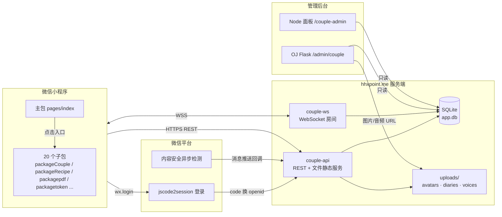

# 整体架构

> 本文说明 `answer` 小程序的全局结构、子包划分、前后端通信与设计规范。

---

## 1. 技术栈

| 层 | 技术 | 说明 |
|---|---|---|
| 小程序框架 | 原生微信小程序（WXML / WXSS / JavaScript） | 无跨端框架，直接使用微信能力 |
| 分包 | 主包 + 20 个子包 | 控制主包体积，按需加载 |
| 前端构建/发布 | `miniprogram-ci` | 命令行上传开发版、生成预览二维码 |
| 双人空间服务端 | Node.js 20 + Express 4 + better-sqlite3 + ws | 部署在 `hhxpoint.me`，systemd 管理 |
| 管理后台 | Flask（OJ 项目）子模块 + Node 独立面板 | 只读查看数据，Basic Auth 保护 |
| 内容安全 | 微信 `msgSecCheck`（文本）/ `mediaCheckAsync`（音频） | 异步回调到服务端 |

---

## 2. 总体结构



---

## 3. 小程序分层

### 3.1 主包（10 个页面）

```text
pages/index/index           首页（含「我们的小火苗」与「今天吃什么」入口卡片）
pages/search/search         搜索
pages/quiz/quiz             答题/练习
pages/calc/calc             计算器
pages/user/user             个人中心
pages/loginscan/loginscan   扫码登录
pages/about/about           关于
pages/process/process       处理/流程页
pages/emotion-analysis/...  情绪分析
pages/emotion-history/...   情绪历史
```

### 3.2 子包职责

完整清单与职责见 [modules/overview.md](modules/overview.md)。重点：

- `packageCouple`：**双人私密空间**（小火苗/悄悄话/时光/纪念日/侧耳倾听），本文档核心
- `packageRecipe`：**纯本地菜谱「今天吃什么」**（40 道菜、离线检索、冰箱模式、本地收藏），不依赖服务端
- `packageTrade`：**二手估价与公开市场**（68 款行情、6 维估价、估价单海报、三种卡片直分享）；行情/估价纯本地，发布与公开浏览走 `/trade-api` 人工审核，详见 [modules/trade/README.md](modules/trade/README.md)
- `packagetoken`：单词、算法、考试
- `packagepdf`：哈希、实验、拼图、图片转 PDF、备忘录
- `packageDetect` / `packageAI` / `packageAR`：模型与 AI 相关（独立分包）
- `chess` / `pictionary` / `packageGame`：棋类、你画我猜、AI 游戏教练
- `packageJwzx`：教务（登录/成绩/课表）
- 其余：天气、金融、比特币、粒子、课程、简历、运动、GitHub、资源包

### 3.3 分包策略

- 主包尽量小，重功能全部下沉到子包
- `packageAI` / `packageDetect` 声明为 `independent: true`（独立分包，可脱离主包加载）
- `packageAssets` 只放资源、不注册页面
- 新增页面时必须同步更新 `app.json` 的 `pages` / `subPackages`

---

## 4. 前后端通信（以小火苗模块为例）

### 4.1 登录链路

```text
小程序 wx.login → code
  → POST /couple-api/login { code }
  → 服务端调用微信 jscode2session 换 openid
  → 生成 HMAC 自定义 token（30 天）
  → 小程序存 storage: couple_token / couple_user
  → 之后所有请求带 Authorization: Bearer <token>
```

### 4.2 数据请求

- Base URL：`https://hhxpoint.me/couple-api`
- 统一响应格式：`{ ok: true, ... }` / `{ ok: false, error: { code, msg } }`
- 封装：`packageCouple/utils/couple-api.js`
  - 自动带 token、统一错误提示、401 自动清 token
  - 图片/音频等相对路径统一用 `absUrl()` 补全为 `https://hhxpoint.me/...`

### 4.3 实时通信

- WebSocket：`wss://hhxpoint.me/couple-ws?token=<token>`
- 封装：`packageCouple/utils/couple-ws.js`
  - 心跳 25s、断线指数退避重连、按双人空间分房间
  - 事件示例：
    - `message` / `message_recall`（悄悄话）
    - `pet_update`（小火苗状态）
    - `diary_new` / `diary_delete`（时光）
    - `anniversary_new` / `anniversary_update` / `anniversary_delete`（纪念日）
    - `voice_new` / `voice_recall` / `voice_update`（侧耳倾听）
- 兜底：页面同时做定时对账（拉取最新一页），保证断线期间数据不丢

### 4.4 文件上传与静态访问

| 类型 | 上传方式 | 存储路径 | 访问路径 |
|---|---|---|---|
| 头像 | JSON base64（≤800KB） | `uploads/avatars/` | `/couple-api/files/avatars/xxx` |
| 时光照片 | JSON base64（≤1.2MB，客户端先压缩） | `uploads/diaries/` | `/couple-api/files/diaries/xxx` |
| 语音 | JSON base64（≤1.5MB，≤60s，服务端 ffprobe 校验） | `uploads/voices/` | `/couple-api/files/voices/xxx` |

- 文件名随机（不可枚举），静态服务支持 HTTP Range（音频拖动进度条）
- 撤回/下架只隐藏内容，管理员后台仍可审计原文件

---

## 5. 服务端与管理后台

- 服务端独立于 OJ 项目，部署在 `/home/point/couple`，详见 [modules/couple/server.md](modules/couple/server.md) 与 [ops/deployment.md](ops/deployment.md)
- 管理后台有两种形态：
  1. **OJ 管理后台子模块**：`https://hhxpoint.me/admin/couple/`
     - Flask blueprint：`couple_admin.py` + `templates/admin/couple*.html`
     - 只读读取小火苗 SQLite，与 OJ 原有深色主题一致
  2. **独立 Node 面板**：`https://hhxpoint.me/couple-admin/`（Basic Auth）
- 两者均只读，不写入业务库

---

## 6. 设计规范（UI）

| 维度 | 规范 |
|---|---|
| 主色 | 暖橙 → 珊瑚渐变：`#ffb27a → #ff8a7a`，背景 `#fff9f4 → #ffe3dd` |
| 卡片 | 白/半透明玻璃卡、圆角 32rpx、柔和阴影 |
| 字体 | 正文系统字体；节日小字使用宋体系 `Songti SC / STSong / SimSun / Noto Serif SC` |
| 动效 | 呼吸/上浮/滑入/错峰入场，全部为 CSS 动画，无高频 JS 定时器 |
| 夜间主题 | 「侧耳倾听」使用深蓝夜空 + 月光 + 暖色气泡，与白天暖色形成对比 |
| 可读性 | 关键操作按钮高度 ≥ 88rpx，正文 ≥ 28rpx，重要状态有文字提示 |

---

## 7. 状态与重定向规则（小火苗）

```text
进入任意小火苗页面
  → 未登录：自动 wx.login
  → 未设置昵称/头像：跳转 profile 页（保存后才继续）
  → 未绑定：跳转 bind 页
  → 已绑定：进入 home
```

- 资料页只强制一次（昵称 + 头像），之后直接进入
- 邀请链接/分享卡片携带 `invite=邀请码`，打开后自动加入
- 所有页面在 `onShow` 重新拉取必要数据，避免缓存过期

---

## 8. 发布链路

```text
本地代码 → 静态检查（node --check / WXML 检查 / 页面注册检查）
        → miniprogram-ci upload（版本号 +1）
        → preview 生成预览二维码
        → 微信后台设为体验版 → 体验成员测试
        → 提审 → 发布（人工在公众平台操作）
```

详见 [modules/couple/release.md](modules/couple/release.md)。
