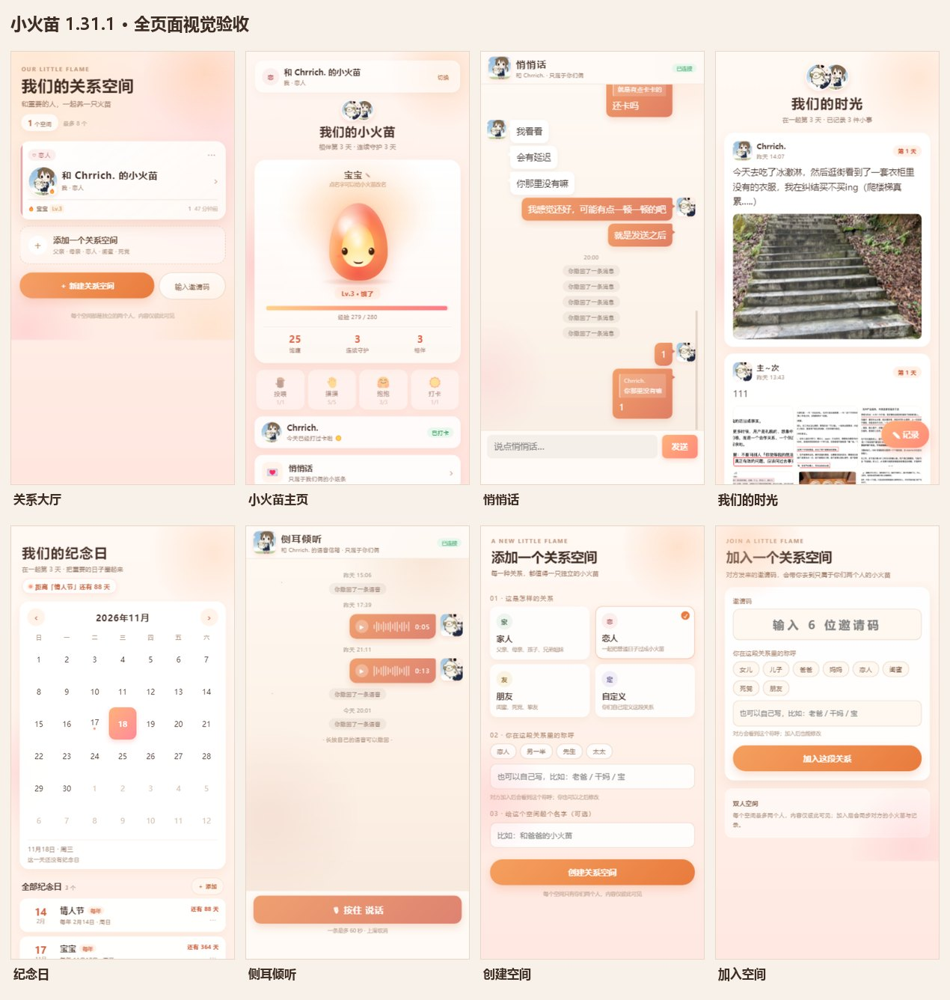
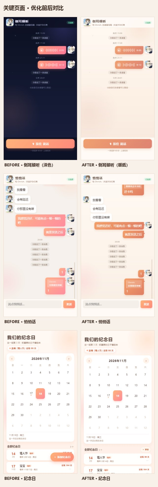

# 小火苗 UI 协调性优化（1.31.1）

> 本轮只做视觉/交互一致性优化，不改业务功能。
> 所有页面均通过微信开发者工具自动化截图逐页检查；优化前后截图见下方与 `docs/assets/couple-ui/`。

---

## 1. 审阅发现的问题

| 页面 | 问题 |
|---|---|
| 侧耳倾听 | **深色夜间主题**与小火苗其他页面的暖白/铜色系统完全冲突，像另一个产品 |
| 悄悄话 | 每条消息重复大尺寸头像，连续消息视觉噪音大；消息引用块偏大；发送状态会成为 flex 子项，可能被挤到气泡旁边 |
| 纪念日 | 标题顶部留白不足；**「＋ 添加纪念日」悬浮按钮压住纪念日卡片**，首条卡片文字被遮挡 |
| 首页 | 顶部空间标题「和Chrrich.的小火苗」中英混排无空格，偏挤 |
| 关系大厅 | 卡片标题同样中英混排无空格 |
| 多个页面 | 顶部安全区/状态栏留白不一致，聊天/语音标题贴边 |

---

## 2. 具体改动

### 侧耳倾听：深色 → 暖纸语音信箱（最大改动）
- 页面底色由 `#0c1020 → #1b2140` 改为 `#fffaf4 → #fdf1e6 → #f7e7db`
- 顶栏、连接状态、时间/系统提示、空状态全部改为暖白/墨棕/铜色
- 对方语音气泡：白色卡片 + 暖边框；自己语音气泡：铜橙渐变
- 播放点、声波、时长、录音浮层、录音按钮、进度条、新语音提示全部统一到同一套暖色
- 保留原有「语音信箱」的安静感，但不再是夜间主题
- 文件：`packageCouple/pages/listen/listen.wxss`

### 悄悄话：消息节奏与层级
- 头像从 76rpx → 64rpx，圆角 16rpx，间距收窄
- **连续同一发送者只显示一次头像**，后续用透明占位保持对齐，减少视觉噪音（`chat.js` buildRows 增加 `showAvatar`）
- 气泡字号 30rpx → 29rpx，最大宽度 66% → 70%，内边距略收紧
- 自己气泡由粉橙渐变改为与首页 CTA 一致的铜橙渐变
- 发送状态移到 `.msg-row` 外部，避免 flex 布局把「发送中/失败重试」挤到气泡旁边
- 聊天页背景加暖色渐变；顶栏增加安全区
- 文件：`chat.js / chat.wxml / chat.wxss`

### 纪念日：去掉遮挡的悬浮按钮
- **移除固定悬浮「＋ 添加纪念日」**
- 在「全部纪念日」标题右侧增加小型「＋ 添加」按钮，不再压住卡片
- 页面底部 padding 180rpx → 80rpx
- 标题顶部增加 64rpx + 安全区留白，缓解贴边
- 文件：`anniversary.wxml / anniversary.wxss`

### 首页 / 关系大厅：中英混排
- 当对方昵称为英文/数字时，标题显示为「和 Chrrich. 的小火苗」，避免中英直接粘连
- 中文昵称保持原样，不额外加空格
- 文件：`home.js / spaces.js`

---

## 3. 视觉验收

逐页截图检查（390×753，DevTools 模拟器）：

- 关系大厅：卡片标题间距正常，关系徽章/宠物行/最近消息对齐
- 小火苗主页：顶部空间标题不再拥挤；宠物卡、四项动作、伙伴打卡、悄悄话入口层级清晰
- 悄悄话：连续消息只显示一次头像；气泡字号/间距更轻；引用块不再挤压
- 我们的时光：未改动布局，与整体暖色一致
- 纪念日：标题有呼吸感；添加按钮移至列表标题栏，首条卡片不再被遮挡
- 侧耳倾听：暖白纸感、铜色语音气泡、珊瑚录音按钮，与聊天页一致
- 创建/加入：保持原有暖色表单，未改业务逻辑

截图目录：`D:\dsh\workplace\tools\wx-auto\v3-*.png`、`v5-chat.png`；仓库内归档：`docs/assets/couple-ui/`。

---

## 4. 回归检查

- WXML/WXSS/JS 编译通过：293 文件 / 产物约 8.22MB
- 未改接口、数据结构、业务逻辑
- 聊天 `showAvatar` 只是渲染字段，不参与消息 DTO 持久化
- 纪念日仅移除悬浮按钮，`goEdit` 绑定保留在列表「＋ 添加」与空态按钮
- 分享封面/文案不变
- 旧版本客户端兼容

---

## 5. 版本

- 版本：**1.31.1**（已上传 DevTools 开发版）
- 上传：微信开发者工具 CLI
- 变更文件：8 个（另有文档与截图归档）
- 详细提交信息见 Git commit
